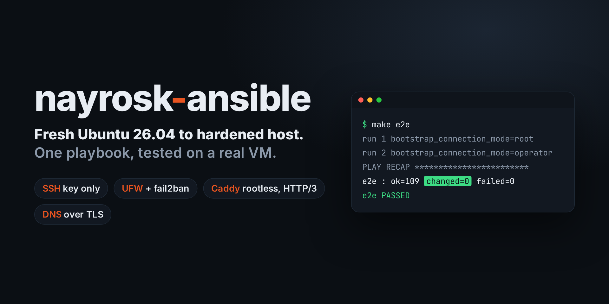
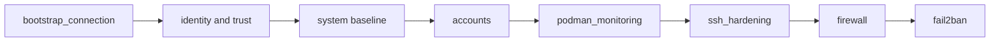

# nayrosk-ansible

Ansible playbooks that turn a fresh Ubuntu 26.04 LTS machine into a hardened host. The first playbook, `install_base`, sets the identity, DNS over TLS, time, updates and firewall, creates a key-only operator account, and runs a rootless Caddy in front of a rootful node_exporter.

[](https://github.com/nayrosk/nayrosk-ansible/actions/workflows/ci.yml)
[](LICENSE)



One command works for the first run and every later run. The first run connects as root with a password. The playbook then creates the operator account and switches to its SSH key.

## What it does

The playbook runs 15 roles in this order. Each role has a tag equal to its name.

- `bootstrap_connection`: picks the operator key or the root password for the connection.
- `hostname`: sets the hostname and its `/etc/hosts` entry.
- `local_ca`: creates a local certificate authority and a server certificate, and fetches the CA to the controller.
- `ubuntu_pro`: attaches the host to Ubuntu Pro and enables Livepatch.
- `dns`: enforces DNS over TLS with systemd-resolved.
- `system`: sysctl hardening, UTC time with chrony, journald limits and the APT mirror.
- `base_packages`: upgrades the system and installs the base packages on first install.
- `unattended_upgrades`: installs security updates automatically.
- `firmware`: applies firmware updates with fwupd on physical hosts.
- `operator_user`: creates the operator account with key-only SSH and passwordless sudo.
- `user_customization`: deploys user dotfiles.
- `podman_monitoring`: runs node_exporter (rootful) and Caddy (rootless) as Podman quadlets. Caddy serves the metrics over HTTPS with basic auth.
- `ssh_hardening`: allows only the operator, with a key, and checks the login before it reloads sshd.
- `firewall`: enables UFW with a default deny policy.
- `fail2ban`: bans repeated SSH and Caddy authentication failures through UFW.



See [architecture](docs/architecture.md) for the detailed flow, the network layout and the connection model.

## Quickstart

Requirements on your workstation: `podman` and `make`. Running the tests also needs `/dev/kvm`. Every other tool runs in a container.

The target machine runs a fresh Ubuntu 26.04 and accepts root with a password over SSH.

1. Copy the example inventory and edit it:

   ```bash
   cp -r inventories/example inventories/prod
   $EDITOR inventories/prod/hosts.yml inventories/prod/group_vars/all/vars.yml
   ```

   Set `ansible_host`, `hostname` and `operator_public_key`.

2. Create the encrypted vault. The example file lists the secrets to put in it:

   ```bash
   make vault-edit VAULT_FILE=inventories/prod/group_vars/all/vault.yml
   ```

3. Connect once to record the host key: the playbook checks host keys and the container sees `~/.ssh`
   read-only, so it cannot add the key itself.

   ```bash
   ssh-keyscan -H <host> >> ~/.ssh/known_hosts   # or: ssh root@<host>, accept the key, then exit
   ```

   A key with a passphrase must be loaded in your SSH agent (`ssh-add`): `make run` forwards the agent
   when `SSH_AUTH_SOCK` is set.

4. Run the playbook. The first run needs `first_install=true`:

   ```bash
   make run INVENTORY=inventories/prod LIMIT=server1 ARGS="-e first_install=true"
   ```

   Later runs do not need the flag.

5. Trust the CA in your browser: import `artifacts/<host>/ca.crt`. Metrics are at `https://<host>/node_exporter`.

`make help` lists every target.

## Documentation

- [Roles and variables](docs/roles.md), generated from the argument specs of each role.
- [Architecture](docs/architecture.md)
- [Operations](docs/operations.md): vault, CA rotation, SSH keys, lockout recovery, known limits.
- [Testing](docs/testing.md)

## Testing

```bash
make lint   # yamllint, ansible-lint, shellcheck, actionlint, zizmor
make e2e    # boots Ubuntu 26.04 in a KVM virtual machine, runs the playbook twice, then verifies
```

The end-to-end test takes about 5 minutes. See [testing](docs/testing.md).

## Contributing

Read [CONTRIBUTING.md](CONTRIBUTING.md). Commits follow Conventional Commits and are signed. After you change a role variable, run `make docs`.

## Release

Releases use semantic versioning. A release is a signed tag `vX.Y.Z`. [CHANGELOG.md](CHANGELOG.md) is generated by git-cliff with `make changelog`.

## License

MIT, see [LICENSE](LICENSE).
