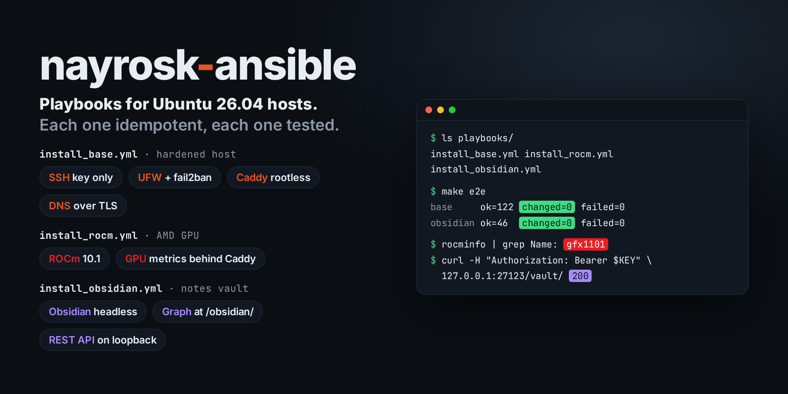

# nayrosk-ansible

Ansible playbooks that turn a fresh Ubuntu 26.04 LTS machine into a hardened host, then add optional services on
top of it.

[](https://github.com/nayrosk/nayrosk-ansible/actions/workflows/ci.yml)
[](LICENSE)



## Playbooks

| Playbook | What it sets up |
| --- | --- |
| `playbooks/install_base.yml` | The hardened host: key-only SSH, firewall, fail2ban, DNS over TLS, automatic updates, and a rootless Caddy that serves the host metrics over HTTPS. |
| `playbooks/install_rocm.yml` | The AMD ROCm stack and GPU metrics, on hosts with a supported AMD GPU. |
| `playbooks/install_obsidian.yml` | A headless Obsidian with its graph view in the browser and a REST API on the host loopback. |
| `playbooks/install_opencode_route.yml` | A Caddy route to the opencode server of the operator, for remote clients such as the OpenCode Mobile app. opencode itself is installed by hand. |
| `playbooks/install_libvirt.yml` | A QEMU/KVM hypervisor managed with virsh and virt-manager over SSH, with Windows and Linux guest support, an optional LAN bridge, PCI passthrough and libvirt metrics. |

Every playbook is idempotent: the same command does the first run and every later one. Run `install_base.yml`
first; the others build on it.

## Quickstart

You need `podman` 4.1 or later and `make` on your workstation. Every other tool runs in a container. The target
runs a fresh Ubuntu 26.04 and accepts an SSH password login as root or as a sudo user.

```bash
cp -r inventories/example inventories/prod          # then edit hosts.yml and group_vars/all/vars.yml
make vault-edit VAULT_FILE=inventories/prod/group_vars/all/vault.yml
ssh-keyscan -H <host> >> ~/.ssh/known_hosts
make run INVENTORY=inventories/prod LIMIT=server1 ARGS="-e first_install=true"
```

Later runs drop `first_install=true`. [Operations](docs/operations.md) explains each step, the vault and the
optional playbooks. `make help` lists every target.

## Documentation

- [Architecture](docs/architecture.md): the playbooks, the role order, the network layout and how Ansible connects.
- [Operations](docs/operations.md): first run, vault, certificates, SSH keys, lockout recovery, ROCm, virtual machines, Obsidian, opencode.
- [Roles and variables](docs/roles.md): every role and its variables, generated from the argument specs.
- [Testing](docs/testing.md): lint, unit checks and the end-to-end test in a KVM virtual machine.

## Contributing

Read [CONTRIBUTING.md](CONTRIBUTING.md). Commits follow Conventional Commits and are signed. Releases are signed
`vX.Y.Z` tags, with [CHANGELOG.md](CHANGELOG.md) generated by git-cliff.

## License

MIT, see [LICENSE](LICENSE).
