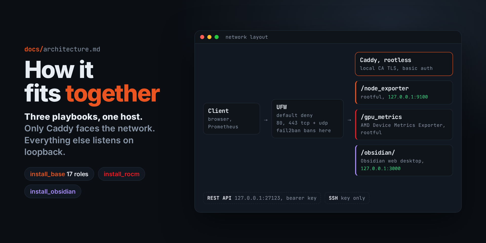
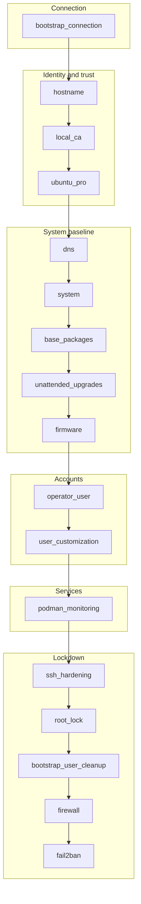
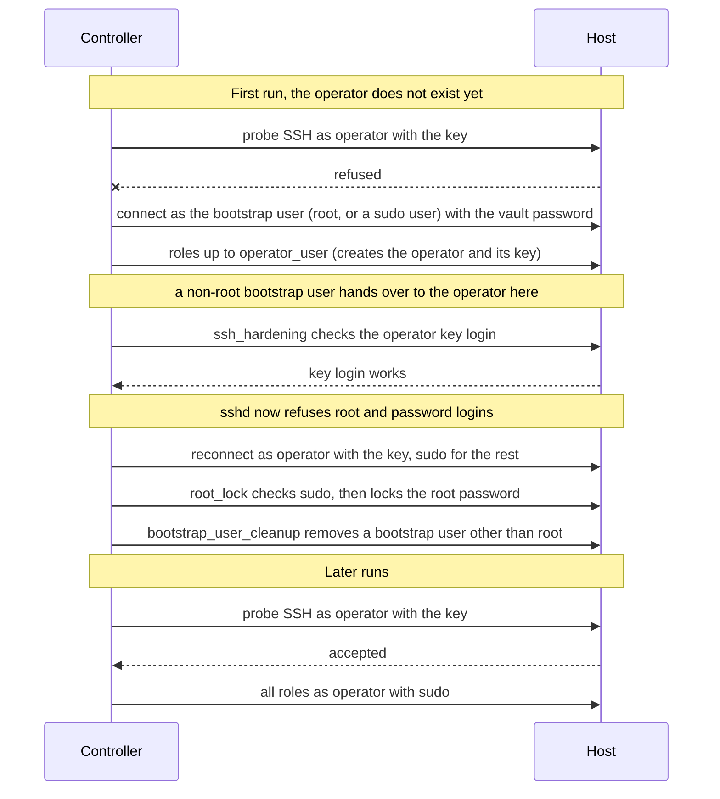

# Architecture



This page shows how the playbooks are organised, how the services are wired and how Ansible connects to the
host.

## Playbooks

| Playbook | Hosts | Roles |
| --- | --- | --- |
| `playbooks/install_base.yml` | all | the 17 roles below |
| `playbooks/install_rocm.yml` | `gpu` group | `bootstrap_connection`, `rocm`, `gpu_metrics_exporter` |
| `playbooks/install_obsidian.yml` | `obsidian` group | `bootstrap_connection`, `obsidian` |
| `playbooks/install_libvirt.yml` | `libvirt` group | `bootstrap_connection`, `libvirt`, `libvirt_exporter` |
| `playbooks/install_opencode_route.yml` | `opencode` group | `bootstrap_connection`, `opencode_route` |

The optional playbooks run after `install_base.yml`: they reuse the operator account and add their route
to its rootless Caddy. `rocm` installs the ROCm stack with `amdgpu-install` and never reboots.
`gpu_metrics_exporter` serves the AMD Device Metrics Exporter at `https://<host>/gpu_metrics`. `obsidian` runs
the Obsidian application at `https://<host>/obsidian/` and its Local REST API on the host loopback. `libvirt`
turns the host into a KVM hypervisor managed by the operator over SSH, with an optional LAN bridge and PCI
passthrough. `libvirt_exporter` serves the libvirt metrics at `https://<host>/libvirt_metrics`. `opencode_route` serves the
operator's opencode server at `https://<host>/opencode/`.

## Playbook flow

`playbooks/install_base.yml` runs 17 roles in a fixed order. Each role has a tag equal to its name.
`bootstrap_connection` always runs, so a tag filter still picks the right account.



Why this order:

- `local_ca` runs before `podman_monitoring`, which needs the server certificate and the facts
  `local_ca_local_ip` and `local_ca_public_ip`.
- `base_packages` installs podman, UFW and fail2ban before the roles that use them.
- `operator_user` runs before `podman_monitoring`, because Caddy runs rootless under that account. When the
  bootstrap user is not root, `operator_user` also moves the play to the operator: Ansible cannot hand that
  user's temporary files to the operator for the rootless Caddy tasks.
- `ssh_hardening` comes late. It checks that the operator can log in with the key, then refuses root and
  password logins. The rest of the play runs as the operator.
- `root_lock` runs right after `ssh_hardening`. The first run connects as the bootstrap user with the password
  until `ssh_hardening` switches to the operator, so locking root earlier would break a reconnection.
- `bootstrap_user_cleanup` follows for the same reason: it removes the bootstrap user, when it is not root,
  only once the play runs as the operator.
- `firewall` enables UFW last, after the SSH rule exists. `fail2ban` follows because its ban action is UFW.

## Network layout

```mermaid
flowchart LR
    client((Client)) -->|"80/tcp, 443/tcp, 443/udp"| ufw["UFW (default deny)"]
    f2b["fail2ban<br/>jails sshd and caddy-auth"] -.->|bans through UFW| ufw
    subgraph host["Host"]
        ufw --> pasta["pasta port forward<br/>(client IP preserved)"]
        subgraph rootless["operator, rootless"]
            pasta --> caddy["Caddy<br/>TLS + basic auth"]
            net[("monitoring network<br/>reserved for future services")]
        end
        subgraph rootful["root, rootful"]
            ne["node_exporter<br/>host network<br/>127.0.0.1:9100"]
        end
        caddy -->|"host.containers.internal:9100<br/>pasta maps it to the host loopback"| ne
    end
    caddy -. access.log .-> f2b
```

- node_exporter is rootful because it reads host metrics. It listens on the host loopback only, so nothing
  outside the machine can reach it.
- Caddy is rootless and runs as the operator. Its ports go through pasta, which listens on the host like any
  process. UFW rules and fail2ban bans therefore apply, and Caddy sees the real client address.
- Caddy terminates TLS with the certificate issued by `local_ca`, asks for basic auth on every route and
  proxies `/node_exporter` to node_exporter.
- Other playbooks add Caddy routes without editing this role. The site block imports
  `~/.caddy/routes.d/*.caddy`, and the `route` entry point of `podman_monitoring` (set
  `podman_monitoring_route_name` and `podman_monitoring_route_content`, then
  `include_role` with `tasks_from: route`) validates and installs one snippet and restarts Caddy.
- `playbooks/install_obsidian.yml` adds a second rootless container of the operator, `obsidian`. It publishes
  two ports on the host loopback only: the web interface (`127.0.0.1:3000`), which Caddy serves at
  `/obsidian/` through a `routes.d` snippet, and the Local REST API of the vault (`127.0.0.1:27123`), which
  has no Caddy route and no firewall rule. Local clients authenticate to the API with a bearer key. The vault
  is a directory of the operator, `~/.obsidian-app/vaults/<name>`, mounted in the container.
- `playbooks/install_opencode_route.yml` adds the route `/opencode/*` to the opencode server of the operator,
  which runs outside this repo on the host loopback (`127.0.0.1:4096` by default). Caddy strips the prefix.
  opencode checks its own basic auth on every API request, so `podman_monitoring_caddy_basic_auth_skip_paths`
  lists the route and the Caddy basic auth skips it. Caddy still logs the 401 answers for fail2ban.
- The `monitoring` network exists for future rootless services. Caddy is not on it yet. See
  [operations](operations.md#decisions-and-known-limits).
- fail2ban reads the Caddy JSON access log and bans clients that fail basic auth, and bans SSH brute force.
- `playbooks/install_libvirt.yml` adds the virtual machine networks. The libvirt NAT network `default`
  (`virbr0`, 192.168.122.0/24) gets UFW rules that only match traffic entering on `virbr0`: DHCP and DNS to
  libvirt's dnsmasq, and routing out through the uplink. With `libvirt_bridge_enabled`, the uplink joins the
  bridge `br0`, which takes the host address and MAC; guests on the `host-bridge` network are LAN hosts. Their
  frames cross the bridge without going through iptables (`bridge-nf-call-*` set to 0 whenever
  `br_netfilter` loads), so UFW does not filter them. The rootful `libvirt-exporter` reads the read-only libvirt
  socket and listens on `127.0.0.1:9177`; Caddy serves it at `/libvirt_metrics` through a `routes.d` snippet.

## Connection model

One command works for the first run and every later run. The `bootstrap_connection` role probes the
operator account with the SSH key and picks the account for the rest of the play.



The bootstrap user is `bootstrap_connection_user`: `root` by default, or an account with sudo rights, such
as the `ubuntu` user of a stock install. Such a user logs in with its password and runs `sudo` with the same
password, `vault_bootstrap_password`.

The role sets the fact `bootstrap_connection_mode` to `bootstrap` or `operator`. The end-to-end test asserts
it for both runs.
