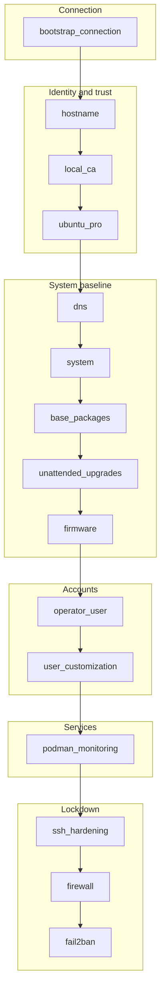
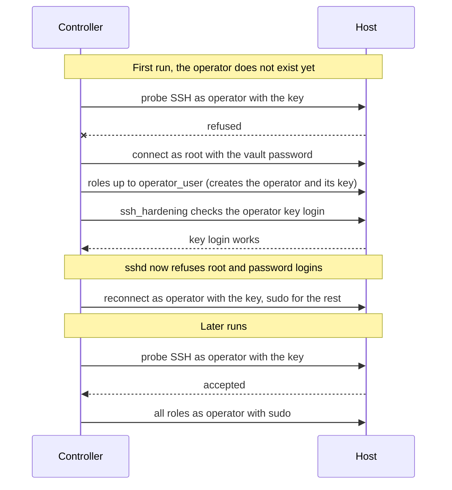

# Architecture

This page shows how the `install_base` playbook is organised, how the monitoring stack is wired and how
Ansible connects to the host.

## Playbook flow

`playbooks/install_base.yml` runs 14 roles in a fixed order. Each role has a tag equal to its name.
`bootstrap_connection` always runs, so a tag filter still picks the right account.



Why this order:

- `local_ca` runs before `podman_monitoring`, which needs the server certificate and the facts
  `local_ca_local_ip` and `local_ca_public_ip`.
- `base_packages` installs podman, UFW and fail2ban before the roles that use them.
- `operator_user` runs before `podman_monitoring`, because Caddy runs rootless under that account.
- `ssh_hardening` comes late. It checks that the operator can log in with the key, then refuses root and
  password logins. The rest of the play runs as the operator.
- `firewall` enables UFW last, after the SSH rule exists. `fail2ban` follows because its ban action is UFW.

## Network layout

```mermaid
flowchart LR
    client((Client)) -->|"80/tcp, 443/tcp, 443/udp"| ufw["UFW (default deny)"]
    f2b["fail2ban<br/>jails sshd and caddy-auth"] -.->|bans through UFW| ufw
    subgraph host["Host"]
        ufw --> pasta["pasta port forward<br/>(client IP preserved)"]
        subgraph rootless["operator, rootless"]
            pasta --> caddy["Caddy<br/>TLS + basic auth"]
            net[("monitoring network<br/>reserved for future services")]
        end
        subgraph rootful["root, rootful"]
            ne["node_exporter<br/>host network<br/>127.0.0.1:9100"]
        end
        caddy -->|"host.containers.internal:9100<br/>pasta maps it to the host loopback"| ne
    end
    caddy -. access.log .-> f2b
```

- node_exporter is rootful because it reads host metrics. It listens on the host loopback only, so nothing
  outside the machine can reach it.
- Caddy is rootless and runs as the operator. Its ports go through pasta, which listens on the host like any
  process. UFW rules and fail2ban bans therefore apply, and Caddy sees the real client address.
- Caddy terminates TLS with the certificate issued by `local_ca`, asks for basic auth on every route and
  proxies `/node_exporter` to node_exporter.
- The `monitoring` network exists for future rootless services. Caddy is not on it yet. See
  [operations](operations.md#decisions-and-known-limits).
- fail2ban reads the Caddy JSON access log and bans clients that fail basic auth, and bans SSH brute force.

## Connection model

One command works for the first run and every later run. The `bootstrap_connection` role probes the
operator account with the SSH key and picks the account for the rest of the play.



The role sets the fact `bootstrap_connection_mode` to `root` or `operator`. The end-to-end test asserts it
for both runs.
