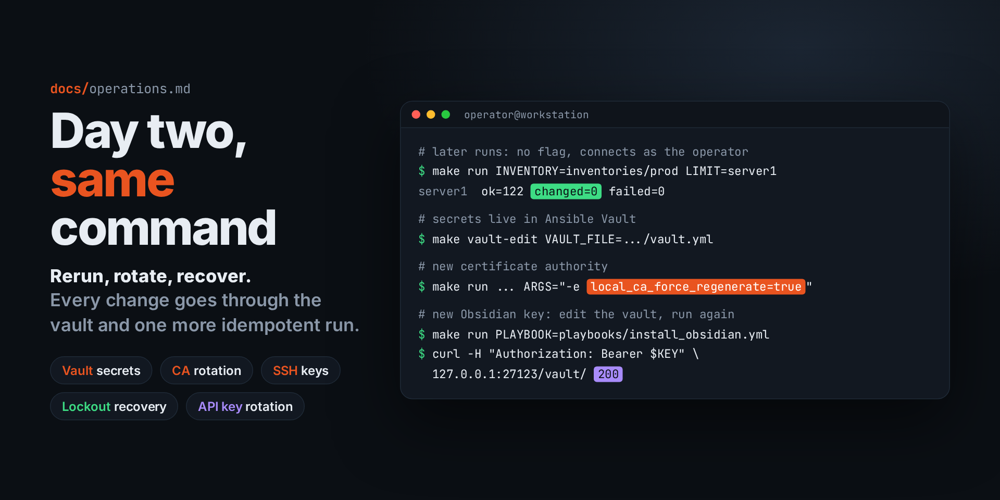

# Operations



How to run the playbooks, keep them healthy and recover from mistakes.

## Prepare the inventory

Copy the example inventory and edit it:

```bash
cp -r inventories/example inventories/prod
$EDITOR inventories/prod/hosts.yml inventories/prod/group_vars/all/vars.yml
```

Set `ansible_host`, `hostname` and `operator_public_key`. When the first login is not root, also set
`bootstrap_connection_user`: the playbook removes that user once the operator works. Then create the vault
(see [Vault](#vault)).

## First install and later runs

The same command covers both. The `first_install` variable gates the steps that must not repeat: the
APT dist-upgrade and package install, the APT mirror measurement, the Ubuntu Pro attach and the firmware
update.

Before the first run, record the host key on your workstation. `make run` mounts `~/.ssh` read-only in the
controller container, so SSH cannot add a new host key there:

```bash
ssh-keyscan -H 203.0.113.10 >> ~/.ssh/known_hosts   # or connect once: ssh root@203.0.113.10
```

When your key has a passphrase, load it in your SSH agent (`ssh-add ~/.ssh/id_ed25519`). `make run` forwards
the agent socket into the container when `SSH_AUTH_SOCK` is set. Without an agent, only a key without a
passphrase works.

```bash
# First run on a fresh machine: the bootstrap user with the vault password, then the operator with the key.
make run INVENTORY=inventories/prod ARGS="-e first_install=true"

# Every later run: idempotent (the APT mirror chosen on the first run is kept), runs as the operator.
make run INVENTORY=inventories/prod
```

Useful filters:

```bash
make run INVENTORY=inventories/prod LIMIT=server1        # one host
make run INVENTORY=inventories/prod TAGS=dns,firewall    # some roles
```

Each role has a tag equal to its name. `bootstrap_connection` always runs. The `podman_monitoring` role needs
the facts of `local_ca`, so select both: `TAGS=local_ca,podman_monitoring`.

`make run` reads `.vault-pass` when the file exists and asks for the vault password otherwise. `.vault-pass`
is ignored by git.

## Vault

Secrets live in `group_vars/all/vault.yml` of the inventory, encrypted with Ansible Vault. The names are
`vault_bootstrap_password`, `vault_ubuntu_pro_token` and `vault_caddy_basic_auth_hash`.
`vault_bootstrap_password` is the password of the bootstrap user (`bootstrap_connection_user`, root by
default). `vault_root_password` is its older name and is still read when `vault_bootstrap_password` is not
defined. The example is in
`inventories/example/group_vars/all/vault.yml.example`.

```bash
make vault-edit VAULT_FILE=inventories/prod/group_vars/all/vault.yml
```

The target creates the file when it is missing and edits it otherwise.

Produce the Caddy password hash with the pinned Caddy image:

```bash
podman run --rm docker.io/library/caddy:2.11.8-alpine caddy hash-password --plaintext '<password>'
```

## Certificate authority

`local_ca` creates one CA per host, valid for 10 years, and a server certificate valid for 1 year. The
server certificate is issued again when its names change, when the CA changes or when less than 30 days
remain, so a regular run renews it.

The certificate names the hostname, the local IP and the public IP. The target asks
`https://ipv4.icanhazip.com` for its public IPv4 address. When that fails, the public IP already in the
certificate is kept, so a run without internet access does not reissue it. Set `local_ca_public_ip_override`
in the inventory to choose the public IP yourself, for example behind NAT or on an IPv6-only host:

```yaml
local_ca_public_ip_override: 203.0.113.10
```

Fetch the CA certificate. Every run copies it to the controller:

```
artifacts/<host>/ca.crt
```

Import it in your browser or system to trust the HTTPS endpoint:

- Firefox: Settings, Privacy and Security, Certificates, View Certificates, Authorities, Import.
- Chrome and Chromium: Settings, Privacy and security, Security, Manage certificates, Authorities, Import.
- curl: `curl --cacert artifacts/<host>/ca.crt https://<host>/node_exporter`.

Rotate the CA, for example after a key leak:

```bash
make run INVENTORY=inventories/prod ARGS="-e local_ca_force_regenerate=true"
```

This replaces the CA and the server certificate and restarts Caddy. Import the new `ca.crt` again on every
client. Run it once, then drop the flag.

## SSH keys

The operator account has exactly one authorized key set from `operator_public_key`. The role replaces the
file on every run, so a key added by hand disappears. To add or replace a key, change the variable and run
the playbook again. Several keys go in the same string, one per line:

```yaml
operator_public_key: |
  ssh-ed25519 AAAA... laptop
  ssh-ed25519 AAAA... backup
```

## Troubleshooting a lockout

`ssh_hardening` is the only role that can cut your access, so it protects itself:

1. It fails before any change when the operator is not in `ssh_hardening_allow_users`.
2. It runs `sshd -t` on the new configuration.
3. The controller opens a real SSH connection as the operator with the key. On failure the role removes the
   drop-in and stops.
4. After the reload it probes the operator login again. On failure it restores the previous files, reloads
   sshd over the connection that is still open and stops.

If you are locked out anyway (wrong key in `operator_public_key`, for example), you need a root shell on the
host. `root_lock` locks the root password after `ssh_hardening`, and the operator password is locked too, so
the console login does not work. Get a shell one of these ways:

- Single-user mode from GRUB: add `init=/bin/bash` to the kernel line, boot, then run
  `mount -o remount,rw /`. The shell runs on the installed system.
- Rescue mode of your provider: it boots a separate system. Mount the installed root filesystem and chroot
  into it before you change anything, or the commands below act on the rescue system:

  ```bash
  lsblk                                   # find the root partition of the host, for example /dev/sda1
  mount /dev/sda1 /mnt
  chroot /mnt
  ```

Run `passwd -u root` if you want the console login back, or `passwd root` when root never had a password
(`passwd -u` then has nothing to restore). If you then rely on the root SSH fallback (option 2 below), use the
value of `vault_bootstrap_password` (or `vault_root_password`). That vault sits in `group_vars/all` and serves every host, so do not change it
for one host. To give this host its own root password, set `vault_bootstrap_password` in an encrypted vault for
that host only, from the controller: `make vault-edit VAULT_FILE=inventories/prod/host_vars/<host>/vault.yml`
(replace `inventories/prod` with your inventory). Encrypt it with the same vault password as the inventory
vault: `make run` passes one password and cannot decrypt a file encrypted with another. Neither shell runs the
systemd of the host, so `systemctl` does not work there: make the repairs below, then boot the host normally
(leave the chroot and reboot from the rescue system, or `sync` then `reboot -f` in single-user mode).

Log in as root on the console directly only when root has a password and it is unlocked:
`root_lock_enabled: false` since the first run, or `passwd -u root` run since. Setting
`root_lock_enabled: false` later does not unlock it.

Two ways out:

1. Fix the operator key. This is the simplest and keeps the hardening:

   ```bash
   echo 'ssh-ed25519 AAAA... you@laptop' > /home/operator/.ssh/authorized_keys
   ```

   Then put the same key in `operator_public_key` and run the playbook again.

2. Restore the SSH configuration from before the hardening. Removing `00-hardening.conf` alone is not
   enough: the role also commented out `PermitRootLogin` and `PasswordAuthentication` in the other files of
   `/etc/ssh/sshd_config.d/`, so sshd falls back to its own defaults, which refuse a root password. The role
   kept a copy of every file it changed, named `<file>.<number>.<date>~` next to it. Put the copies back,
   then reload (from a rescue or single-user shell, skip the reload and reboot the host instead):

   ```bash
   cd /etc/ssh/sshd_config.d
   ls -l                                   # find the backups, for example 50-cloud-init.conf.1234.2026-10-28@10:00:00~
   cp -p 50-cloud-init.conf.1234.2026-10-28@10:00:00~ 50-cloud-init.conf
   rm 00-hardening.conf                    # or restore its own backup if it had one
   sshd -t && systemctl reload ssh
   ```

   Root can log in with its password again until the next run, if its password is unlocked. Fix
   `operator_public_key`, then run the playbook. If the inventory sets another `bootstrap_connection_user`,
   that account was removed by `bootstrap_user_cleanup`: set `bootstrap_connection_user: root` and the root
   password in `vault_bootstrap_password` for this run.

Other quick checks on the host:

```bash
sudo ufw status verbose            # firewall rules
sudo fail2ban-client status        # jails sshd and caddy-auth
sudo fail2ban-client status caddy-auth
sudo fail2ban-client unban <ip>    # unban a client
```

fail2ban never bans loopback, `fe80::/10`, `fail2ban_ignoreip_extra` and the detected LAN networks. A
detected network counts only when it is private (`10.0.0.0/8`, `172.16.0.0/12`, `192.168.0.0/16`,
`100.64.0.0/10`, `fc00::/7`): a public subnet of a hosting provider is not whitelisted. Add your own
addresses to `fail2ban_ignoreip_extra` when you need them. The `caddy-auth` jail counts only 401 answers to
requests that carried a user and password, so the first anonymous request of a browser never counts.

## Unattended upgrades

`unattended_upgrades` installs security updates only and enables the apt-daily timers. It does not reboot
unless `unattended_upgrades_automatic_reboot` is true; then the host reboots at
`unattended_upgrades_automatic_reboot_time` when an update needs it. Without automatic reboot, check
`/var/run/reboot-required` now and then.

## Ubuntu Pro

Set `vault_ubuntu_pro_token` to attach the host on the first install. The role runs
`pro attach --no-auto-enable`, skips hosts that are already attached and enables Livepatch when
`ubuntu_pro_livepatch` is true. An empty token skips the whole step. To attach later, run once with
`-e first_install=true` and the token set.

## ROCm and GPU metrics

`playbooks/install_rocm.yml` targets the `gpu` group of the inventory. Run `install_base.yml` first: the
exporter needs the Caddy routes directory it creates. Add the host to `gpu` and run:

```bash
make run PLAYBOOK=playbooks/install_rocm.yml INVENTORY=inventories/prod LIMIT=server1
```

The `rocm` role checks the hardware before it changes anything and never reboots. After the first install,
reboot the host by hand, then run the playbook again. The second run verifies the stack with `rocminfo` and
`amd-smi`. While the DKMS module is built but not loaded, the role reports that a reboot is needed. When DKMS
has no module for the running kernel, it fails and names the kernel.

Prometheus scrapes the exporter through Caddy, with the same basic auth and certificate as node_exporter (see
[architecture](architecture.md) for the `routes.d` extension point):

```yaml
scrape_configs:
  - job_name: gpu_metrics
    scheme: https
    metrics_path: /gpu_metrics
    basic_auth:
      username: operator
      password_file: /etc/prometheus/gpu_metrics.password
    tls_config:
      ca_file: /etc/prometheus/server1-ca.crt
    static_configs:
      - targets: ["server1.example.com"]
```

`username` is `podman_monitoring_caddy_basic_auth_user`. `ca_file` is the `artifacts/<host>/ca.crt` fetched by
`local_ca`.

Bump `amdgpu-install` by hand. repo.radeon.com has no Renovate datasource. Find the new release under
`https://repo.radeon.com/amdgpu-install/`, then set `rocm_amdgpu_install_version` and
`rocm_amdgpu_install_package_version` in the inventory (defaults live in `roles/rocm/defaults/main.yml`) and run
the playbook. Reboot, run it again, and check the result with `tests/gpu/verify.yml` (see
[testing](testing.md#gpu-host-test)).

When `amdgpu-install` fails, the role stops and never uninstalls. Recover by hand, then rerun:

```bash
sudo amdgpu-install --uninstall
sudo reboot
```

The exporter image is tracked by Renovate. Its pull request notes ask you to diff the upstream
`example/config.json` against the field allow-list in `roles/gpu_metrics_exporter/vars/main.yml`.

## Virtual machines

`playbooks/install_libvirt.yml` targets the `libvirt` group of the inventory. Run `install_base.yml` first: the
libvirt exporter needs the Caddy routes directory it creates. Add the host to `libvirt` and run:

```bash
make run PLAYBOOK=playbooks/install_libvirt.yml INVENTORY=inventories/prod LIMIT=server1
```

### Connect

libvirt opens no network port. virsh and virt-manager reach it over the operator SSH login, which the role adds
to the `libvirt` and `kvm` groups:

```bash
virsh -c qemu+ssh://operator@server1/system list --all
virt-manager -c qemu+ssh://operator@server1/system
```

The virt-manager console (SPICE or VNC) goes through the same SSH connection, with `nc` on the host.

### Networks

- `default`: the libvirt NAT network, 192.168.122.0/24 on `virbr0`. Guests get a lease and reach the outside;
  nothing on the LAN can reach them. The role adds UFW rules for it, scoped to traffic entering on `virbr0`.
- `host-bridge`, only with `libvirt_bridge_enabled: true`: guests attached to it sit on the LAN with their own
  address from the LAN DHCP server, and the host and its guests see each other. Pick it as the network source
  in virt-manager, or `--network network=host-bridge` with virt-install.

Bridged guests are not filtered by the host firewall: UFW only protects the host. Run a firewall in each guest.

### The LAN bridge

Set `libvirt_bridge_enabled: true` for the host. The role adds `/etc/netplan/60-libvirt-bridge.yaml`, which
moves the address settings of the uplink (DHCP or static, read from the existing netplan files) to `br0` and
gives `br0` the uplink MAC. The host keeps its IPv4 lease and its SLAAC IPv6 address; a DHCPv6 address may
change. Add a DHCP reservation for the host MAC on the router so the IPv4 address never moves.

The change is applied like `netplan try`. Before `netplan apply`, the host arms a timer
(`libvirt_bridge_rollback_timeout`, 120 seconds) that restores the previous netplan config. The controller
reconnects, checks that `br0` holds the host address and that the gateway answers, then cancels the timer. If
any of that fails, the play stops with "The bridge setup failed ... and was rolled back", and the host is back
on its previous config within the timeout. Check `journalctl -t libvirt-bridge` on the host, fix the cause
(often a different DHCP lease), and run the playbook again.

To remove the bridge, from the console or another path than the bridged link:

```bash
sudo rm /etc/netplan/60-libvirt-bridge.yaml
sudo ip link delete br0
sudo netplan apply
virsh -c qemu:///system net-destroy host-bridge
virsh -c qemu:///system net-undefine host-bridge
```

Then set `libvirt_bridge_enabled: false`, so the next run does not add it back.

### Windows guests

The host has OVMF (UEFI with Secure Boot: pick `OVMF_CODE_4M.ms.fd` with `OVMF_VARS_4M.ms.fd`) and swtpm (add
a TPM 2.0 device, emulated). The virtio-win driver ISO is at
`/var/lib/libvirt/images/virtio-win-<version>.iso`: attach it as a second CD-ROM to load the storage driver
during setup, then run its guest tools installer inside Windows.

Bump virtio-win by hand: fedorapeople.org has no Renovate datasource and publishes no ISO checksum. Pick the
release under `https://fedorapeople.org/groups/virt/virtio-win/direct-downloads/archive-virtio/`, download its
ISO, and set `libvirt_virtio_win_version` and `libvirt_virtio_win_sha256` (`sha256sum` of the file).

### PCI passthrough

Set `libvirt_passthrough_enabled: true`. The role adds the IOMMU kernel arguments to GRUB (`iommu=pt` on AMD,
`intel_iommu=on iommu=pt` on Intel), loads the VFIO modules, and reports when a reboot is needed; it never
reboots. Reboot by hand after the first run, then run the playbook again: it checks that the IOMMU exposes
groups.

Find the ids and the IOMMU group of each device:

```bash
lspci -nn
for d in /sys/kernel/iommu_groups/*/devices/*; do g=${d#*/iommu_groups/}; echo "group ${g%%/*}: $(lspci -nns ${d##*/})"; done
```

A device goes to a VM together with every other device of its group. Two ways to hand it over:

- Dynamic (default, `libvirt_passthrough_vfio_ids: []`): the device stays with its host driver. Add it to the
  VM in virt-manager (Add Hardware, PCI Host Device); libvirt detaches it when the VM starts (`managed="yes"`)
  and gives it back when the VM stops. The VM fails to start while a host process holds the device.
- At boot (`libvirt_passthrough_vfio_ids: ["1002:747e", "1002:ab30"]`): `vfio-pci` claims the listed ids
  before their driver loads. The host never uses those devices. The role warns when a listed device shares its
  group with unlisted ones.

A GPU that also serves the host (ROCm, the GPU exporter of `install_rocm.yml`) is best handed over
dynamically. Before starting a VM that uses it, stop what holds it on the host:

```bash
sudo systemctl stop device-metrics-exporter.service
# stop any ROCm job, then start the VM; after the VM stops:
sudo systemctl start device-metrics-exporter.service
```

### Metrics

Prometheus scrapes the libvirt exporter through Caddy, like the GPU exporter:

```yaml
scrape_configs:
  - job_name: libvirt
    scheme: https
    metrics_path: /libvirt_metrics
    basic_auth:
      username: operator
      password_file: /etc/prometheus/libvirt.password
    tls_config:
      ca_file: /etc/prometheus/server1-ca.crt
    static_configs:
      - targets: ["server1.example.com"]
```

The exporter image is tracked by Renovate.

## Obsidian

`playbooks/install_obsidian.yml` targets the `obsidian` group of the inventory. Run `install_base.yml` first:
the role needs the operator account, its quadlet directory and the Caddy routes directory.

1. Add the API key to the vault (`make vault-edit VAULT_FILE=inventories/prod/group_vars/all/vault.yml`). It
   must be at least 32 characters. `openssl rand -hex 32` prints a suitable one.

   ```yaml
   vault_obsidian_api_key: "<64 hexadecimal characters>"
   ```

2. Add the host to the `obsidian` group in `hosts.yml` and run:

   ```bash
   make run PLAYBOOK=playbooks/install_obsidian.yml INVENTORY=inventories/prod LIMIT=server1
   ```

Open `https://<host>/obsidian/` and log in with the Caddy basic auth user. The page shows the Obsidian window
with the vault already open. The graph view is the icon in the left ribbon.

The vault is a plain directory of Markdown files on the host, `~operator/.obsidian-app/vaults/vault`
(`obsidian_vault_name` changes the last part). The application state is in `~operator/.obsidian-app/config`.
The application runs with umask 077, so the notes and settings it writes are readable by the operator only.
Back up the vault directory to keep the notes. The role never rewrites notes, and keeps other settings and
plugins changed in the interface. Every run enforces these, and undoes a change made to them in the interface:

- the Local REST API plugin files, and in its `data.json` the API key, the `Authorization` header name, the HTTP
  server on port 27123, the HTTPS server off and the binding address (change the key in the vault, not in the plugin settings);
- the plugin entry in `community-plugins.json`, and the restricted mode of the vault turned off;
- in the application `obsidian.json`: the vault opened at start, the command line client on, self-update off.

A client on the host calls the Local REST API over plain HTTP on the loopback, with the key as a bearer token:

```bash
curl -H "Authorization: Bearer $KEY" http://127.0.0.1:27123/vault/
```

The API is not routed by Caddy and no firewall rule opens its port. To reach it from another machine, use an
SSH tunnel.

- Rotate the key: change `vault_obsidian_api_key` and run the playbook. It restarts Obsidian, and at the end
  checks the API accepts the key; if the plugin still holds an old one, it restarts Obsidian again.
- Upgrade Obsidian: Renovate proposes new image tags (`obsidian_version`). The application does not update
  itself: the role sets `updateDisabled` so the pinned image decides the version.
- Upgrade the plugin: set `obsidian_rest_api_version` in `defaults/main.yml` only. Set the three checksums in
  `obsidian_rest_api_checksums` (`sha256sum` of `main.js`, `manifest.json` and `styles.css` of the release) in
  both `defaults/main.yml` and `meta/argument_specs.yml`, run `make docs`, then run the playbook.
- Logs: `journalctl --user -u obsidian.service` as the operator.

## Decisions and known limits

- Whoever passes the Caddy basic auth on `/obsidian/` controls a desktop session in the Obsidian container,
  with a terminal. The application runs as root inside the container, which is the operator account on the
  host, confined to the container, the vault and the application state. Treat the basic auth password as a
  login to that container.
- Obsidian keeps community plugins off until restricted mode is disabled for a vault, and stores that choice
  in the application storage, not in a file. The `obsidian` role disables it with the Obsidian command line
  client inside the container, which is why the role enables that client (`cli` in `obsidian.json`).
- The Obsidian container has no GPU. The graph view is rendered in software, which is enough for a personal
  vault.

- Caddy runs on pasta, not on the `monitoring` network. A rootless bridge network publishes ports through
  `rootlessport`, which hides the client address: every request would look like it came from the
  container, and the fail2ban `caddy-auth` jail could not ban anybody. pasta keeps the client address. The
  `monitoring` network is created and waits for future rootless services. Caddy can join it once Podman 6
  or later, with the pasta port forwarder for bridge networks, is available on the target.
- Caddy reaches node_exporter through `host.containers.internal`, mapped by pasta to the host loopback. The
  mapping is scoped to the Caddy container, and node_exporter stays on `127.0.0.1:9100`.
  `podman_monitoring_node_exporter_listen` must remain a loopback address.
- pasta copies the host addresses and routes once, when Caddy starts. If the uplink is down at that moment,
  as during a link flap at boot, pasta falls back to a link-local `169.254` address and Caddy never answers
  on the host address, even after the uplink returns. The Caddy healthcheck requires an address of each
  family the host had when the playbook ran: an IPv4 address outside `169.254.0.0/16`, and an IPv6 address
  other than link-local. When one is missing, Podman kills the container and systemd starts it again with the
  current addresses. Recovery takes about one to two minutes after the uplink returns. Run the playbook again
  after the host gains or loses an address family, so the check follows.
- node_exporter runs with `apparmor=unconfined`. The default Podman AppArmor profile denies D-Bus calls, and
  the systemd collector needs them. The container already shares the host PID and network namespaces and
  sees the root filesystem read-only.
- node_exporter has no init process, because the host PID namespace forbids one. The host systemd reaps
  orphans. The end-to-end test checks for zombies.
- UFW applies `/etc/ufw/sysctl.conf` at every start and ships `log_martians=0`. The `firewall` role sets it
  to `1` in that file so UFW does not undo the `system` role.
- Stopping a container on a rootless network can log `rootless netns: kill network process: permission
  denied` because of the `pasta` AppArmor profile of Ubuntu 26.04. It is harmless.
- One CA per host. There is no shared CA across hosts.
- Not covered: a Prometheus server, Grafana and alerting.
