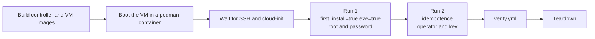

# Testing

`make e2e` installs the playbook on a real Ubuntu 26.04 machine and checks the result. Nothing runs on your
workstation except `podman` and `make`.

## Requirements

- `podman` and `make`.
- `/dev/kvm`. The test boots a full virtual machine with qemu and needs hardware virtualisation. The script
  stops with a clear message when the device is missing.
- Network access to download the Ubuntu cloud image once. It is cached in `.cache/images` and checked
  against a pinned SHA256.

## Run it

```bash
make e2e              # build the images, run the test, remove the VM
make e2e KEEP=1       # leave the VM running afterwards
make e2e-clean        # remove a VM left by KEEP=1
```

With `KEEP=1` the VM stays reachable at `ssh -p 2222 root@127.0.0.1` (and, once the playbook has run, as
the operator with the key in `inventories/e2e/.ssh/`). Ports 8080 and 8443 forward to HTTP and HTTPS on the
VM.

A full run takes about 5 minutes once the images and the cloud image are cached. The first run takes longer.

## What happens



- Run 1 connects as root with the password and asserts `bootstrap_connection_mode=root`.
- Run 2 must change nothing. `tests/e2e/check-idempotence.sh` fails when any task reports `changed`. It also
  asserts `bootstrap_connection_mode=operator`.
- Logs go to `artifacts/e2e/` (`run1.log`, `run2.log`, `verify.log`, `vm-console.log`).

## What verify checks

`tests/e2e/verify.yml` asserts on the final state:

- HTTPS with the fetched CA certificate: 401 without credentials, 200 with them, `/node_exporter` returns
  node_exporter metrics including `node_systemd_unit_state`, port 80 redirects to HTTPS with 308 and the
  `alt-svc` header advertises HTTP/3.
- SSH: root login and password login are refused, the operator key login works.
- UFW: default policies and the four commented rules. fail2ban: the `sshd` and `caddy-auth` jails.
- Both containers report `healthy`.
- DNS over TLS is active, chrony is synchronised, the time zone is UTC, the operator has UID and GID 10000,
  lingering is enabled and the sysctl values are applied.

## Zombie check

node_exporter runs with the host PID namespace, which forbids an init process. The host systemd reaps its
orphans. Set `E2E_ZOMBIE_CHECK=1` to wait five minutes for healthchecks to run and assert that no process
is a zombie:

```bash
E2E_ZOMBIE_CHECK=1 make e2e
```

CI always sets it. The default run skips the wait to stay short.

## Design notes

- The images are built with `podman run` followed by `podman commit` (`scripts/build-image.sh`), not with
  `podman build`. `podman build` is blocked on some hardened kernels, and the commit approach needs the same
  provisioning script and nothing else.
- The VM runs inside a podman container, with `--device /dev/kvm`. The controller runs in a second container
  with the host network and reaches the VM through forwarded ports on `127.0.0.1`.
- The e2e inventory has its own vault, encrypted with a password stored in the repository
  (`tests/e2e/vault-pass`). It protects nothing. It only exercises the same code path as a real inventory.
- Steps that cannot run in a VM are skipped when `e2e` is true: firmware updates and APT mirror timing.
- Ubuntu Pro is never attached in the e2e run, in CI included: the e2e vault token is empty, because every
  throwaway VM would take one machine slot of the Pro subscription. The attach task is checked to be
  skipped. The attach path is therefore not tested automatically.

## Unit checks

`make unit` runs `tests/unit/` on the controller, without a VM. It checks the fail2ban `ignoreip` logic
(which detected networks count as private) on fixed IPv4 and IPv6 cases.

## Lint

`make lint` runs yamllint (strict), ansible-lint (production profile), shellcheck, actionlint and zizmor,
all in the controller image. `make docs CHECK=1` verifies that the generated role documentation is current.
