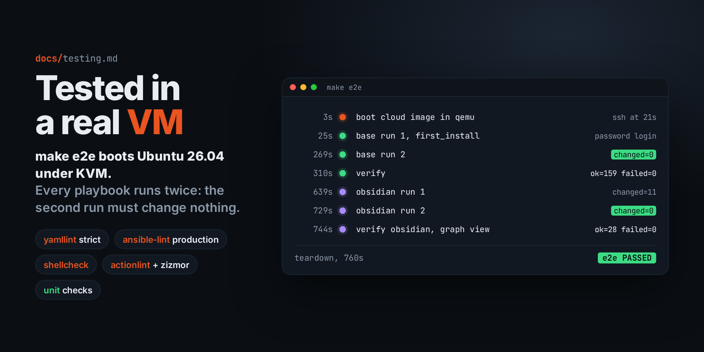

# Testing



`make e2e` installs the playbook on a real Ubuntu 26.04 machine and checks the result. Nothing runs on your
workstation except `podman` and `make`.

## Requirements

- `podman` and `make`.
- `/dev/kvm`. The test boots a full virtual machine with qemu and needs hardware virtualisation. The script
  stops with a clear message when the device is missing.
- Network access to download the Ubuntu cloud image once. It is cached in `.cache/images` and checked
  against a pinned SHA256.

## Run it

```bash
make e2e              # build the images, run the test, remove the VM
make e2e KEEP=1       # leave the VM running afterwards
make e2e-clean        # remove a VM left by KEEP=1
```

With `KEEP=1` the VM stays reachable at `ssh -p 2222 root@127.0.0.1` (and, once the playbook has run, as
the operator with the key in `inventories/e2e/.ssh/`). Ports 8080 and 8443 forward to HTTP and HTTPS on the
VM.

The VM container shares the host network (`--network host`) and qemu binds its forwarded ports to
`127.0.0.1` on the host. Podman published ports are not used: with podman 4.9 (slirp4netns and
rootlessport, as on GitHub `ubuntu-latest` runners) rootlessport accepts connections but never relays them
to the qemu forward, so SSH never answers. Ports 2222, 8080 and 8443 must be free on the host loopback.

A full run takes about 5 minutes once the images and the cloud image are cached. The first run takes longer.

## What happens


- Run 1 connects as the `ubuntu` user with its password and `sudo`, as on a stock install, and asserts
  `bootstrap_connection_mode=bootstrap`. cloud-init makes `sudo` ask for the `ubuntu` password, as a stock
  install does, and the harness checks it before run 1. cloud-init also gives root a password, so verify can
  check that root is refused.
- Run 2 must change nothing. `tests/e2e/check-idempotence.sh` fails when any task reports `changed`. It also
  asserts `bootstrap_connection_mode=operator`.
- `install_obsidian.yml` then runs twice on the same VM, which is in the `obsidian` group of the e2e inventory.
  The second run goes through `check-idempotence.sh` too. The image is about 3.6 GB, so these steps add a few
  minutes.
- `install_libvirt.yml` then runs twice too, the VM being in the `libvirt` group. The VM runs with `-cpu host`,
  so nested KVM gives it `/dev/kvm`. The e2e inventory enables the bridge: run 1 bridges the VM NIC under the
  rollback timer (the QEMU user network gives the bridge the same lease, so SSH keeps working), run 2 must not
  touch it. Passthrough stays off: the VM has no device to pass through. The rollback itself was exercised by
  hand on a kept VM (`make e2e KEEP=1`, then a run that forces the post-apply check to fail).
- `install_opencode_route.yml` then runs twice too, the VM being in the `opencode` group. The e2e inventory
  lists `/opencode/*` in `podman_monitoring_caddy_basic_auth_skip_paths`. opencode is not installed in the VM.
- Logs go to `artifacts/e2e/` (`run1.log`, `run2.log`, `verify.log`, `obsidian-run1.log`, `obsidian-run2.log`,
  `verify-obsidian.log`, `libvirt-run1.log`, `libvirt-run2.log`, `verify-libvirt.log`, `opencode-run1.log`,
  `opencode-run2.log`, `verify-opencode.log`, `vm-console.log`).

## What verify checks

`tests/e2e/verify.yml` asserts on the final state:

- HTTPS with the fetched CA certificate: 401 without credentials, 200 with them, `/node_exporter` returns
  node_exporter metrics including `node_systemd_unit_state`, port 80 redirects to HTTPS with 308 and the
  `alt-svc` header advertises HTTP/3.
- SSH: root login and password login are refused, the operator key login works.
- The bootstrap user `ubuntu` is gone: no account, no home directory, no sudoers rule, no password login.
- UFW: default policies and the four commented rules. fail2ban: the `sshd` and `caddy-auth` jails.
- Both containers report `healthy`.
- DNS over TLS is active, chrony is synchronised, the time zone is UTC, the operator has UID and GID 10000,
  lingering is enabled and the sysctl values are applied.
- Caddy recovers from an uplink outage at start: the test restarts it while the uplink is down, checks it
  started on the pasta link-local fallback, then waits for it to answer on the host address again.

`tests/e2e/verify_obsidian.yml` asserts on the Obsidian state:

- The `obsidian` user unit is active and its container reports `healthy`.
- Through Caddy: `/obsidian/` and `/obsidian` answer 401 without credentials, `/obsidian` redirects to
  `/obsidian/` with them, `/obsidian/` answers 200, the WebSocket of the desktop stream upgrades (101) with
  credentials and is refused (401) without, and the REST API path `/vault/` is not routed (404).
- The Local REST API on `127.0.0.1:27123` answers 401 without a key or with a wrong key, and 200 with the key.
  Two notes written through it exist as files of the operator in the vault directory.
- The graph view opens: the VM has no browser, so the test opens it with the Obsidian command line client and
  finds its canvas in the application. How it looks in a browser is checked by eye on a real host.
- The web interface and the API listen on `127.0.0.1` only, and UFW opens neither port.

`tests/e2e/verify_libvirt.yml` asserts on the libvirt state:

- The host packages are installed, OVMF (Secure Boot variants) and swtpm are present.
- The operator is in the `libvirt` and `kvm` groups and lists the domains of `qemu:///system` without root.
- The `default` NAT network is active and starts at boot, and UFW holds its DHCP, DNS and route rules.
- `br0` holds the VM NIC, and the `host-bridge` network is active and starts at boot.
- The virtio-win ISO matches the pinned SHA256.
- The `libvirt-exporter` unit is active, `/libvirt_metrics` answers 401 without credentials and serves
  `libvirt_up 1` with them.

`tests/e2e/verify_opencode_route.yml` starts a stub HTTP server on the opencode port and asserts:

- `/opencode/api/info` answers 200 without the Caddy credentials, with the stub body: Caddy skips its basic
  auth on the route and strips the prefix.
- `/node_exporter`, `/opencode` and `/opencodex/api/info` still answer 401 without credentials.

## Zombie check

node_exporter runs with the host PID namespace, which forbids an init process. The host systemd reaps its
orphans. Set `E2E_ZOMBIE_CHECK=1` to wait five minutes for healthchecks to run and assert that no process
is a zombie:

```bash
E2E_ZOMBIE_CHECK=1 make e2e
```

CI always sets it. The default run skips the wait to stay short.

## Design notes

- The images are built with `podman run` followed by `podman commit` (`scripts/build-image.sh`), not with
  `podman build`. `podman build` is blocked on some hardened kernels, and the commit approach needs the same
  provisioning script and nothing else.
- The VM runs inside a podman container, with `--device /dev/kvm`. The controller runs in a second container
  with the host network and reaches the VM through forwarded ports on `127.0.0.1`.
- The e2e inventory has its own vault, encrypted with a password stored in the repository
  (`tests/e2e/vault-pass`). It protects nothing. It only exercises the same code path as a real inventory.
- Steps that cannot run in a VM are skipped when `e2e` is true: firmware updates and APT mirror timing.
- Ubuntu Pro is never attached in the e2e run, in CI included: the e2e vault token is empty, because every
  throwaway VM would take one machine slot of the Pro subscription. The attach task is checked to be
  skipped. The attach path is therefore not tested automatically.

## GPU host test

CI cannot test `install_rocm.yml`: the e2e VM has no GPU, so the hardware check of the `rocm` role fails by
design. The maintainer runs the test by hand on a real GPU host that already ran `install_base.yml`. Use
`make run PLAYBOOK=playbooks/install_rocm.yml INVENTORY=... LIMIT=...` and pipe a run through
`tests/e2e/check-idempotence.sh` to check it:

1. Run `install_base.yml` (`make run INVENTORY=... LIMIT=...`).
2. Run 1 of `install_rocm.yml`. It installs the stack and reports that a reboot is needed.
3. Run 2 of `install_rocm.yml`, piped through `tests/e2e/check-idempotence.sh`. It must change nothing.
4. Run `tests/gpu/verify.yml`, the file that holds the GPU checks. It expects the card model
   `AMD Radeon RX 7800 XT` and the target `gfx1101`; for another card pass `-e verify_gpu_card_model=...` and
   `-e verify_gpu_gfx_target=...`. `ansible_host` must be an IP address (curl `--resolve` needs one).
5. Reboot the host by hand.
6. Run 3 of `install_rocm.yml`, piped through `check-idempotence.sh`. It must change nothing and now verifies
   `rocminfo` and `amd-smi`.
7. Run `tests/gpu/verify.yml` again.

## Unit checks

`make unit` runs `tests/unit/` on the controller, without a VM, on fixed cases:

- `fail2ban_ignoreip.yml`: the fail2ban `ignoreip` logic (which detected networks count as private).
- `rocm_hardware_check.yml`: the `rocm` hardware check (supported GPU, Secure Boot, OS release).
- `rocm_driver_state.yml`: the `rocm` driver state decision.
- `rocm_install_needed.yml`: the decision whether `amdgpu-install` must run.
- `gpu_metrics_exporter_fields.yml`: the field allow-list built for the `gpu_metrics_exporter` config.
- `obsidian_api_key.yml`: the `obsidian` API key check (missing, empty, short or non-string key), and that a
  failure names `vault_obsidian_api_key` without showing the key.
- `obsidian_merge_json.yml`: the JSON merge of the `obsidian` role (foreign keys and list items kept, no
  rewrite when nothing differs).
- `libvirt_bridge_config.yml`: the bridge netplan document built from the uplink config (DHCP, static, MTU and
  IPv6 settings, an uplink with no address, the same document on a second run).
- `libvirt_passthrough.yml`: the passthrough kernel arguments per CPU vendor and the IOMMU group warnings.

## Lint

`make lint` runs yamllint (strict), ansible-lint (production profile), shellcheck, actionlint and zizmor,
all in the controller image. `make docs CHECK=1` verifies that the generated role documentation is current.
